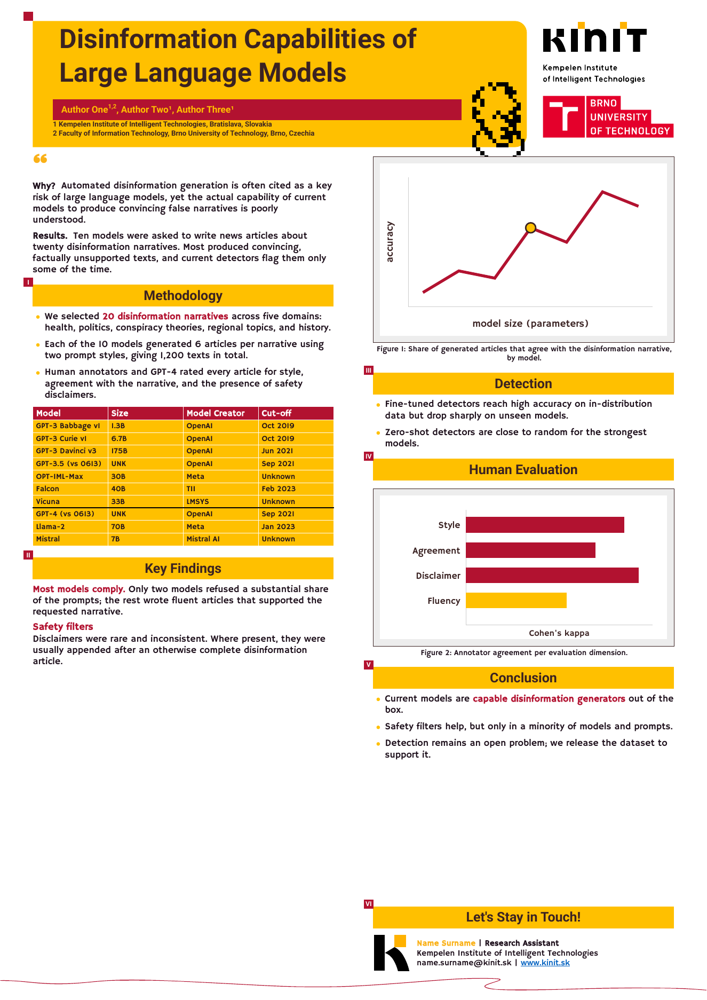

# KInIT poster template for Typst

Turn a single plaintext file into a print-ready A0 poster in the visual style
of the [Kempelen Institute of Intelligent Technologies](https://kinit.sk).
Figures stay vector, fonts are embedded, and the whole thing builds in under a
second.

<p align="center">
  
</p>

The template is a port of the institute's Google Slides / PowerPoint poster
template (kept in [`reference/`](reference/)) to [Typst](https://typst.app),
a modern typesetting system with a Markdown-like syntax.

## Quick start

1. **Install Typst** (one binary, no TeX or Python needed):

   ```sh
   brew install typst            # macOS
   winget install Typst.Typst    # Windows
   cargo install typst-cli       # anywhere with Rust
   ```

   Or use the [typst.app](https://typst.app) web editor: upload this
   repository as a project and everything works without installing anything.

2. **Copy the example** and edit it:

   ```sh
   git clone https://github.com/kinit-sk/kinit-template
   cd kinit-template
   cp -r example my-poster
   $EDITOR my-poster/poster.typ
   ```

3. **Build**:

   ```sh
   ./build.sh my-poster/poster.typ --png
   ```

   This writes `my-poster/poster.pdf` (and a `poster.png` preview), then
   checks that the poster fits on one A0 page, that every font is embedded,
   and reports how many raster images ended up in the PDF. The checks need
   `poppler-utils` (`brew install poppler` / `apt install poppler-utils`);
   without it you still get the PDF.

   Without the script, the equivalent command is:

   ```sh
   typst compile --root . --font-path fonts --ignore-system-fonts my-poster/poster.typ
   ```

   For live preview while editing, use `typst watch` with the same flags.

## Writing a poster

A poster is one file. Metadata goes at the top, the body is Typst markup,
and `#colbreak()` moves to the right column.

```typst
#import "../kinit-poster.typ": *

#show: poster.with(
  title: [Disinformation Capabilities of Large Language Models],
  authors: (
    (name: "Author One", affiliations: (1, 2)),
    (name: "Author Two", affiliations: (1,)),
  ),
  affiliations: (
    "Kempelen Institute of Intelligent Technologies, Bratislava, Slovakia",
    "Faculty of Information Technology, Brno University of Technology, Brno, Czechia",
  ),
  why: [Short motivation behind the research.],
  results: [TLDR of the findings.],
  contact: (
    name: "Name Surname",
    role: "Research Assistant",
    institute: "Kempelen Institute of Intelligent Technologies",
    email: "name.surname@kinit.sk",
    web: "www.kinit.sk",
  ),
)

= Methodology

- We selected *20 narratives* across five domains.
- Each model generated _six articles_ per narrative.

#kinit-table(
  header: ("Model", "Size", "Creator"),
  rows: (
    ("GPT-4", "UNK", "OpenAI"),
    ("Llama-2", "70B", "Meta"),
  ),
  group-after: 1,
)

#colbreak()

#figure(
  image("figures/results.svg"),
  caption: [Share of articles agreeing with the narrative.],
)

= Conclusion

- Current models are *capable generators* out of the box.
```

### Markup reference

| You write | You get |
|---|---|
| `= Heading` | Yellow section bar with a numbered crimson square (I, II, ...). Numbering runs down the left column and continues in the right one. |
| `== Heading` | Crimson bold sub-heading inside a section. |
| plain paragraph | Body text in Hammersmith One, 32 pt. |
| `- item` | Bullet with a yellow dot. |
| `*text*` | Crimson bold emphasis, as in the original template. |
| `_text_` | Italic (synthesised; the body font has no italic face). |
| `#colbreak()` | Start the right column. |
| `#figure(image("f.svg"), caption: [...])` | Framed figure at column width with a centred "Figure N: ..." caption. |
| `#kinit-table(header:, rows:, group-after:, columns:)` | Table with a crimson header and yellow rows. `group-after: n` draws a heavy black rule under body row `n`. `columns` accepts Typst track sizes such as `(2fr, 1fr, 1fr)`. |
| `#v(10mm)` | Extra vertical space, if you need to nudge something. |

Anything else Typst can do also works: `#link`, math (`$x^2$`), `#grid` for
side-by-side figures, and so on. See the
[Typst documentation](https://typst.app/docs).

### Metadata fields

| Field | Type | Notes |
|---|---|---|
| `title` | content | Rendered in Roboto Bold, 90 pt. Two lines fit. |
| `authors` | array of `(name:, affiliations:)` | Affiliation numbers become superscripts. |
| `affiliations` | array of strings | Listed in order under the author bar. |
| `why`, `results` | content | The two lead paragraphs under the quotation mark. Either may be omitted. |
| `contact` | dictionary | `name` is required; `role`, `institute`, `email`, `web` and `heading` are optional. Omit `contact` entirely to drop the box. |

### Figures

Export figures as **SVG** and they are embedded as vector graphics, so they
stay crisp at A0. Matplotlib: `plt.savefig("fig.svg")`. Plotly:
`fig.write_image("fig.svg")`. Text inside the SVG must use a font that is
either outlined or available in the SVG itself; otherwise Typst substitutes
one of the vendored fonts. PNG and JPEG figures work too but should be at
least 300 dpi at their printed size.

### When the poster overflows

Typst never shrinks text to fit. If the content is too long, the poster
spills onto a second page and `build.sh` fails with an overflow error. Fix it
by shortening text, giving figures an explicit width
(`image("f.svg", width: 70%)`), or moving content across the `#colbreak()`.

## Repository layout

```
kinit-poster.typ     the template: page geometry, theme, header, sections, table, figure, contact box
example/poster.typ   complete example, the file you copy
example/figures/     sample SVG figures
assets/              vector logos, mascot and footer wave (see assets/README.md)
fonts/               vendored Roboto, Hammersmith One and Ultra with licenses
build.sh             compile + verification
reference/           the original PPTX/PDF template and a render of it
```

## Design notes

Page geometry, colours and font sizes were measured from the original
PowerPoint export: A0 portrait, two 358 mm columns with a 47 mm gutter, yellow
`#FFC000`, crimson `#B21230`, dark `#3A2222`. The header, logos, mascot and
footer wave are placed at fixed coordinates in the page background, so body
text can never push them around. The body flows through the two columns like
ordinary text.

Hammersmith One ships only a Regular face, so bold text is produced with a
thin outline stroke, exactly as PowerPoint did in the original.

## License

The template code is MIT licensed. Fonts are under the SIL Open Font License
and Apache 2.0 (see [`fonts/README.md`](fonts/README.md)). The KInIT and Brno
University of Technology logos belong to their institutions and are included
for producing posters affiliated with them.
